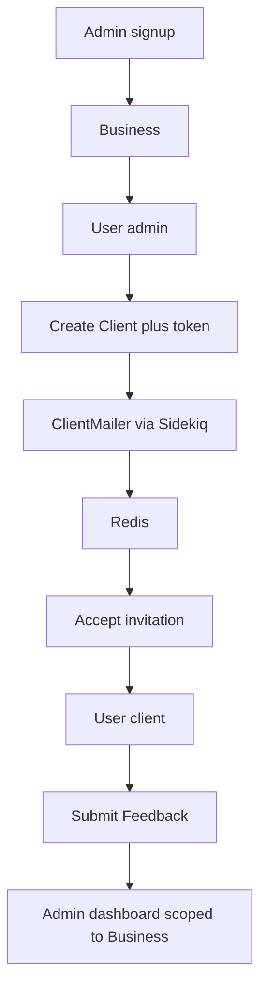

# Client Feedback Platform — Implementation Plan

## Current inspection (do not modify)

Workspace today is the Windows home directory. Your WSL Ubuntu home is `/home/claw`.

[`/home/claw/store`](/home/claw/store) is already a Rails 8.1.3 app (`module Store`, Ruby `3.4.10`, SQLite, Solid Queue/Cache/Cable, Turbo/Stimulus, unused `Product` model, **no git commits**). **It will be left completely alone.**

Ruby/Rails are expected under WSL user `claw` (mise). All generation, tests, and commits will run **inside WSL**, not on Windows.

## Project location

- New app: **`/home/claw/feedback-platform`** (change if you pick a different name)
- Before any files are written: create the directory, `git init`, then `move_agent_to_root` to that path
- Feature branch after the Rails generator commit: `feature/client-feedback-platform`

## Architecture

Simple multi-tenant ownership, not an engine or apartment gem.

```text
Business
  |-- User (role: admin)     # business owner accounts
  |-- Client                 # CRM record; user_id set when invitation accepted
        |-- User (role: client)
        |-- Feedback         # text + Active Storage photos + voice
```

**Why a separate `Client` from `User`:** invitations exist before an account; admins manage name/phone independently of login; a client CRM row is not the same as credentials.

**Authorization (IDOR):** every lookup is scoped.

- Admin: `Current.business.clients.find(params[:id])` — never `Client.find`
- Client: `current_user.client.feedbacks.find(params[:id])`
- Roles set only in server code (admin signup creates a Business + admin User; invitation acceptance creates a client User). Never accept `role` from params.

**Denormalized `feedbacks.business_id`:** yes — admin dashboards/filters query “all feedback for this business” without joining through clients every time. Constraint: `business_id` must match `client.business_id` (model validation + optional DB check).



## Database schema (PostgreSQL)

**businesses:** `name`, `email` (unique), timestamps. Unique index on email.

**users:** `business_id` (FK, null until we decide — admins always have it; clients have `business_id` too for cheap scoping), `email` unique, `encrypted_password` (Devise), `role` enum `admin|client` (integer, not a user-writable string), timestamps. Index: `business_id`, unique `email`.

**clients:** `business_id` FK not null, `user_id` FK unique nullable, `name`, `email`, `phone` nullable, `invitation_token_digest`, `invitation_sent_at`, `invitation_accepted_at`, `invitation_expires_at`, timestamps. Unique index on `[business_id, email]`. Unique index on `invitation_token_digest` where present.

Store the **digest** of the token, not the raw token. URL carries the raw token only. Expiration default 7 days. Reuse prevented by clearing digest on accept.

**feedbacks:** `client_id` FK not null, `business_id` FK not null, `body` text nullable, timestamps. Indexes: `business_id + created_at`, `client_id + created_at`.

**Active Storage** tables (Rails default). Attachments:

- `has_many_attached :photos`
- `has_one_attached :voice_recording`

Validations: at least one of body / photos / voice; Marcel magic-byte content type; size caps (e.g. photos 10MB each, max 5; audio 15MB, webm/mp4/mpeg/ogg). Disk service in dev; `storage.yml` already S3-ready.

## Stack choices (and why)

| Piece | Choice | Why |
| --- | --- | --- |
| App | `rails new` 8.1, Ruby 3.4 | Matches what you already have in WSL |
| DB | PostgreSQL | Required; replace Rails default SQLite |
| Jobs/cache | Redis + **Sidekiq** | Required Redis; invitation mail must be async; Sidekiq is the usual Redis Active Job adapter |
| Auth | **Devise** | Session auth, recoverable passwords; invitations stay custom on `Client` (not `devise_invitable`) |
| Front | ERB, Tailwind, Importmap, Turbo, Stimulus | Required; no SPA |
| Test | Minitest + Capybara (Rails default) | Conventional; fixtures for two-tenant IDOR cases |
| Pagination | **Pagy** | Small, no extra JS framework |
| CSS | `tailwindcss-rails` | Rails-native Tailwind |

Skip Solid Queue/Cache/Cable so Redis is actually used (not a checkbox). Redis roles: Sidekiq queue + `RedisCacheStore` for dashboard summary counts.

Generator (run in WSL as `claw`):

```bash
cd /home/claw
rails new feedback-platform \
  --database=postgresql \
  --css=tailwind \
  --javascript=importmap \
  --skip-jbuilder \
  --skip-solid
```

Then add gems: `devise`, `sidekiq`, `redis`, `pagy`, `image_processing`.

## Routes (REST, shallow)

```ruby
devise_for :users, skip: [:registrations]
# custom admin registration
namespace :admin do
  resources :clients do
    member { post :invite }
  end
  resources :feedbacks, only: [:index, :show]
  get :dashboard, to: "dashboards#show", as: :dashboard
end
namespace :client do
  resource :dashboard, only: :show
  resources :feedbacks, only: [:index, :new, :create, :show]
end
resource :invitation, only: [:show, :update]  # token in query/path, no secrets in token
root to: "pages#home"
```

Admins land on `/admin/dashboard`; clients on `/client/dashboard`. After Devise login, redirect by `role`.

## UX / Hotwire (deliberate, with HTML fallback)

- **Turbo Drive:** navigation
- **Turbo Frames:** client list, feedback filters (`this week / month / year`, client select)
- **Turbo Streams:** create/delete client, flash, feedback create → client history
- **Stimulus:** `voice_recorder` (MediaRecorder), `file_preview`, `modal` if used; no business rules in JS
- Empty states on clients and feedback lists
- Mobile-first feedback form

Voice: start/stop, elapsed time, play/remove, attach Blob as file input; unsupported browser message.

## Security

- Scoped finds; integration tests for cross-business IDs
- Strong params; no `role` / `business_id` from client/admin forms except where admin creates *their* client (business from `Current.business`)
- Invitation: `SecureRandom.urlsafe_base64(32)`, hashed, expiry, single use
- CSRF default; Active Record only
- Uploads: extension + Marcel type + size
- Credentials/env: `.env.example` (`DATABASE_URL`, `REDIS_URL`, `APP_HOST`); never commit `.env` or `master.key` if we document credentials instead

## Testing (behavior, not status-only)

Write tests **in the same phase** as the feature.

- Models: associations, validations, invitation lifecycle, feedback “at least one medium”
- Request/integration: admin CRUD, IDOR, client cannot hit admin routes, invitation happy/expired/reuse
- Active Storage in tests with fixture files
- One system test for the golden path: invite → accept → submit feedback → admin sees it

## Git (assessment-visible history)

`store` is untouched. In the new repo:

1. Commit 1: Rails generator output (`chore: bootstrap Rails 8 app`)
2. Branch `feature/client-feedback-platform`
3. Small commits per phase (examples below). Run tests before each commit. No work on `main` after bootstrap.

## Phased implementation (commit after each)

1. **Bootstrap** — `rails new`, first commit, move agent to app root, branch
2. **Infra** — PostgreSQL, Redis, Sidekiq, Procfile/dev, `.env.example`, Tailwind confirmed
3. **Auth** — Devise, Business + User, admin signup creates business, role enforcement
4. **Admin shell** — layout, dashboard placeholders
5. **Clients CRUD** — scoped, Turbo streams, empty state, Pagy
6. **Invitations** — token, mailer, `DeliverInvitationJob`, accept flow, password set
7. **Client dashboard + feedback text** — create/list, server validation
8. **Attachments** — photos + Stimulus recorder + voice
9. **Admin feedback over time** — filters via Turbo Frame, recent activity, summary counts (Redis cache)
10. **Polish** — a11y, responsive nav, error pages, flash
11. **Perf pass** — `includes`, indexes, pagination, query log check
12. **Security pass** — the IDOR/token/upload checklist
13. **README + walkthrough** — architecture, Redis/jobs, setup (`bundle`, `db:setup`, `bin/dev`, Sidekiq)
14. **Final** — `rails test`, `db:migrate:status`, git status

## Local run (WSL)

PostgreSQL and Redis must be running in Ubuntu. Typical:

```bash
bin/dev          # Rails + Tailwind watch
bundle exec sidekiq
```

Letter Opener or `:file`/`:letter_opener` in development for invitation emails.

## Out of scope

- React/Vue/APIs/SPA
- Changing `/home/claw/store`
- Multi-admin teams, billing, production S3 (config only)
- Over-built analytics/charts (optional sparkline later; list + date filters are enough)
