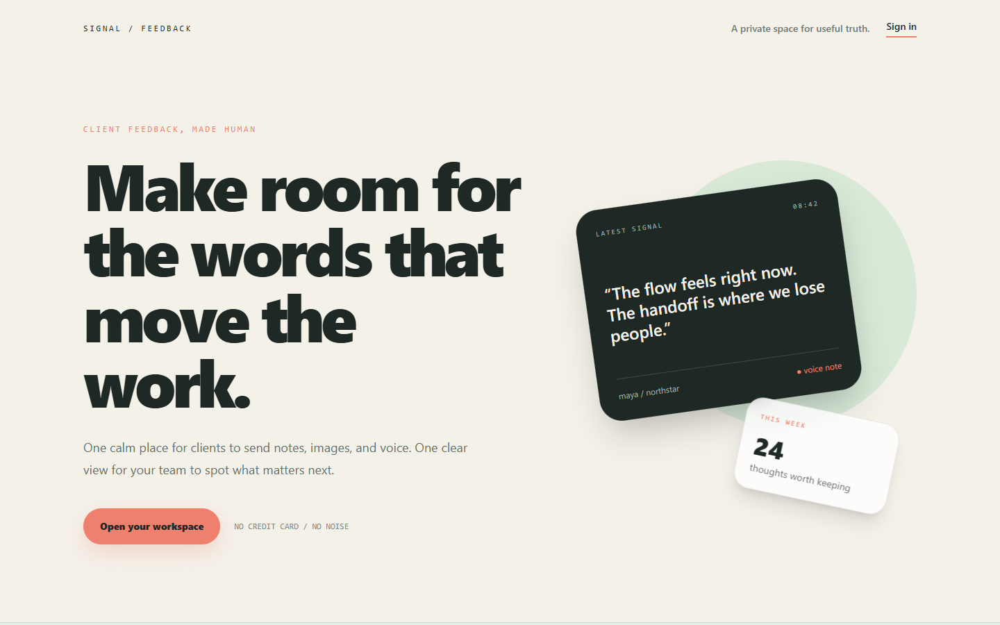
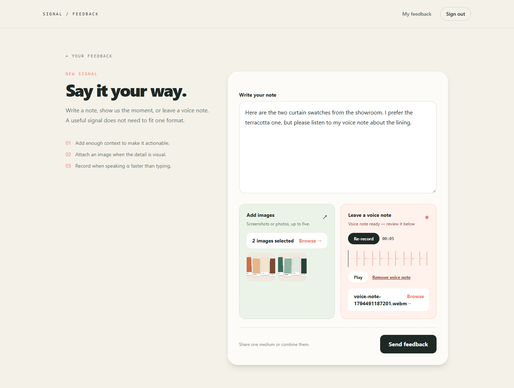
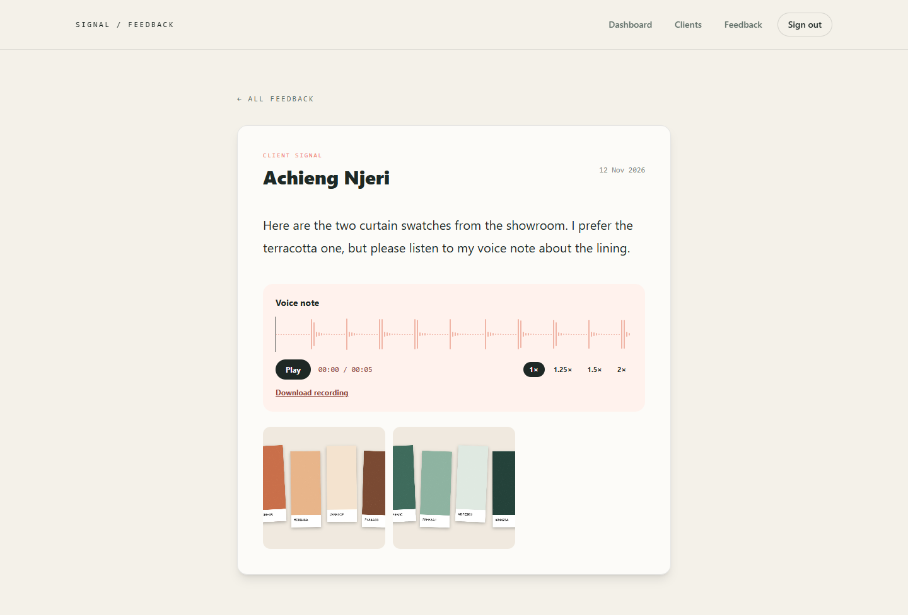
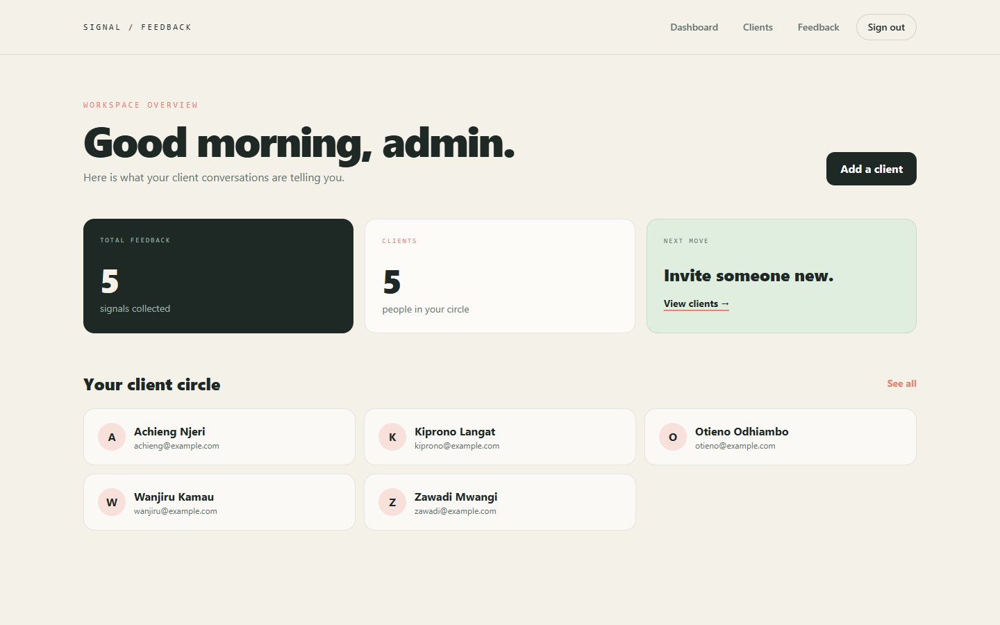

# Feedback Platform

[](https://github.com/stmakori/feedback-platform/actions/workflows/ci.yml)


A multi-tenant client feedback platform. A business invites its clients by email, and each client
gets a private portal where they can send feedback as **text, photos or a recorded voice note**. The
business sees every piece of feedback in one dashboard.

Built with Rails 8, Hotwire (Turbo + Stimulus), Devise, Active Storage, Sidekiq and Tailwind CSS.



## Screenshots

| A client sends feedback: text, photos and a voice note | The business reads it, with playback and photos |
|---|---|
|  |  |



<sub>Screenshots use a demo workspace with made-up clients.</sub>

## Features

**For businesses (admins)**
- Sign up at `/signup` to create a workspace. The first user becomes its admin.
- Add, edit and remove clients (name, email, phone).
- Send a client an email invitation. The link works once and expires after 7 days.
- A dashboard with every client and the feedback count, plus a feedback inbox with photos and a
  playable voice note for each entry.

**For clients**
- Accept the invitation, set a password and land in your own portal.
- Send feedback in any mix of:
  - **Text**
  - **Photos** (several per entry, previewed before sending)
  - **Voice notes**, recorded in the browser: live level meter, pause and resume, re-record, and a
    scrubbable waveform preview before you submit
- See your own feedback history, and nobody else's.

**Platform**
- `/system`: a [RailsAdmin](https://github.com/railsadminteam/rails_admin) back office for the
  platform owner. It sees every business, so only admins listed in `PLATFORM_ADMIN_EMAILS` can open
  it. Business admins are turned away.
- `/up`: a health check for load balancers and uptime monitors.

## How it works

```
Business ──< User (role: admin | client)
    │
    ├──< Client ──< Feedback ──┬── photos (Active Storage, many)
    │      │                   └── voice_recording (Active Storage, one)
    │      └── invitation token (SHA-256 digest only) + expiry
    └──< Feedback
```

- **Tenant isolation.** Every admin query goes through `Current.business` (for example
  `Current.business.clients.find(id)`), so one business can never load another's records. Clients
  only reach feedback through their own `current_user.client` association. `Feedback` also checks
  that its business matches its client's business. Integration tests (`test/integration/access_control_test.rb`)
  check that admins and clients get `404` for another tenant's records, and that only platform
  owners can reach `/system`.
- **Secure invitations.** The raw token is only ever in the email link. The database stores its
  SHA-256 digest, an expiry (7 days) and an accepted time, and the digest is cleared once used.
  Expired or reused links get `410 Gone`.
- **Background delivery.** Invitations go out through `DeliverInvitationJob` on Sidekiq (Redis), so
  the admin's request never waits on SMTP.
- **Voice notes without a custom upload API.** A Stimulus controller records with the browser's
  `MediaRecorder` and shows a live level meter. It then renders a [WaveSurfer.js](https://wavesurfer.xyz)
  preview and puts the recording into the form's normal file input, so it uploads through standard
  Active Storage multipart. WebM, Ogg, MP3 and MP4 audio play inline.

## Tech stack

| Area | Choice |
|---|---|
| Framework | Ruby 3.4, Rails 8.1 |
| Database | PostgreSQL |
| Front end | Hotwire (Turbo, Stimulus), import maps, Tailwind CSS |
| Auth | Devise (database authentication, roles via enum) |
| Files | Active Storage (local disk in development) |
| Jobs and cache | Sidekiq and Redis |
| Admin | RailsAdmin |
| Quality | Minitest, RuboCop (rails-omakase), Brakeman, bundler-audit, importmap audit, all in GitHub Actions |
| Deploy | Dockerfile and Kamal config (Rails 8 defaults) |

## Getting started

You need **Ruby 3.4.10** (see `.ruby-version`), **PostgreSQL** and **Redis**. On Windows, run the app
inside WSL (Ubuntu).

```bash
git clone https://github.com/stmakori/feedback-platform.git
cd feedback-platform
bundle install
bin/rails db:setup        # create the database and load the schema
```

Start the web server and the job worker in two terminals:

```bash
bin/dev                   # Rails on http://localhost:3000
bundle exec sidekiq       # sends invitation emails
```

### Configuration

The app reads plain environment variables. `.env.example` lists them, but nothing loads `.env`
automatically, so export them in your shell, for example with `set -a; source .env; set +a`.

| Variable | Default | Purpose |
|---|---|---|
| `DATABASE_URL` | settings in `config/database.yml` | PostgreSQL connection |
| `REDIS_URL` | `redis://localhost:6379/0` | Sidekiq and cache |
| `APP_HOST` | `localhost:3000` | Host used in invitation links |
| `PLATFORM_ADMIN_EMAILS` | unset (nobody) | Comma-separated admin emails allowed into `/system` |
| `SMTP_ADDRESS`, `SMTP_PORT`, `SMTP_DOMAIN`, `SMTP_USERNAME`, `SMTP_PASSWORD`, `SMTP_AUTHENTICATION` | unset | Real email delivery |

Without `SMTP_ADDRESS`, development emails are **written to `tmp/mails/<recipient>`** instead of being
sent, so you can copy the invitation link from there.

## Try it

1. Open http://localhost:3000/signup and create a business. You land on the admin dashboard.
2. **Clients → New client**: add a client with an email address you can read.
3. Click **Invite**. With Sidekiq running, the invitation appears in `tmp/mails/<that email>` (or in
   your inbox if SMTP is set up).
4. Open the invitation link in a private window, set a password and you're in the client portal.
5. **New feedback**: write a note, attach photos, and record a voice note (allow microphone access).
   Play it back on the waveform, then submit.
6. Back in the admin window, open **Feedback** to read, view and play what the client sent.

## Tests and checks

```bash
bin/rails test            # model, controller and access-control tests
bin/rubocop               # style
bin/brakeman              # static security analysis
bin/bundler-audit         # known-vulnerable gems
bin/importmap audit       # known-vulnerable JavaScript packages
```

CI runs all of these on every push and pull request.

## Project layout

```
app/
├── controllers/
│   ├── admin/            # clients, dashboard, feedback inbox (business-scoped)
│   ├── client/           # client dashboard and feedback (client-scoped)
│   ├── invitations_controller.rb
│   └── registrations_controller.rb   # business signup
├── javascript/controllers/
│   ├── voice_recorder_controller.js  # MediaRecorder, level meter, preview
│   └── waveform_controller.js        # WaveSurfer playback
├── jobs/deliver_invitation_job.rb
├── mailers/client_mailer.rb
└── models/               # Business, User, Client, Feedback, Current
```
